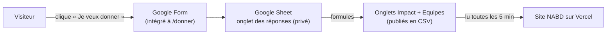

# NABD — Déploiement pas à pas (Google Forms + Google Sheets + Vercel)

NABD n'a **plus de backend ni de base de données** :



- Les inscriptions arrivent dans la Google Sheet liée au formulaire.
- Les chiffres (`/impact`, `/challenge`, page d'accueil) sont lus dans deux onglets publiés : **Impact** et **Equipes**.
- L'onglet des réponses (noms, téléphones…) n'est **jamais** publié.

Le projet de travail se trouve dans l'environnement WSL **NABD** : `wsl -d NABD`, puis `cd ~/nabd`.

---

## Partie 1 — Préparer la Google Sheet

### Étape 1 · Relier le formulaire à une Google Sheet
1. Ouvrir le formulaire en mode édition → onglet **Réponses** → **Associer à Sheets** → **Créer une feuille de calcul** → **Créer**.
2. La feuille s'ouvre avec un onglet **« Réponses au formulaire 1 »**. Les colonnes sont :
   `A` Horodateur · `B` Nom · `C` Âge · `D` Sexe · `E` Téléphone · `F` Email · `G` Ville · `H` Groupe sanguin · `I` Déjà donné · `J` Être recontacté · `K` Remarques · `L` Consentement

> Si l'onglet porte un autre nom (ex. *Form Responses 1*), remplacez ce nom dans toutes les formules ci-dessous.

### Étape 2 · (Recommandé) Ajouter une question « Équipe »
Le challenge a besoin de savoir à quelle équipe appartient chaque inscrit.
1. Dans le formulaire, ajouter une question **Réponse courte** : `Équipe, club ou classe (facultatif) | الفريق أو النادي أو القسم (اختياري)`. Ne pas la rendre obligatoire.
2. Elle apparaîtra dans la colonne **`M`** de l'onglet des réponses.

> Pour éviter les fautes de frappe, vous pouvez utiliser une **Liste déroulante** avec les noms exacts des équipes.

### Étape 3 · Créer l'onglet `Equipes`
1. En bas, cliquer **+** → renommer l'onglet **`Equipes`** (sans accent).
2. Ligne 1, de `A1` à `E1` :

| A | B | C | D | E |
|---|---|---|---|---|
| Equipe | Etablissement | Description | Membres | Dons |

3. Une ligne par équipe (à partir de la ligne 2), par exemple :

| Equipe | Etablissement | Description | Membres | Dons |
|---|---|---|---|---|
| Pulse Club | FMPC Casablanca | Une génération qui se mobilise. | `=COUNTIF('Réponses au formulaire 1'!M:M;A2)` | 0 |

- **Membres** : la formule compte automatiquement les inscrits qui ont écrit ce nom d'équipe (étape 2). Recopier la formule vers le bas (`A2` devient `A3`, `A4`…).
- **Dons** : à saisir **à la main** quand le centre confirme un don. Une inscription n'est pas un don.

### Étape 4 · Créer l'onglet `Impact`
1. **+** → renommer l'onglet **`Impact`**.
2. Remplir les colonnes A et B :

| A (Indicateur) | B (Valeur) |
|---|---|
| Indicateur | Valeur |
| Inscriptions | `=COUNTA('Réponses au formulaire 1'!A2:A)` |
| Dons confirmés | `=SUM(Equipes!E2:E)` (ou un nombre saisi à la main) |
| Equipes | `=COUNTA(Equipes!A2:A)` |
| Villes | `=COUNTUNIQUE('Réponses au formulaire 1'!G2:G)` |
| Objectif | `500` |
| Campagne | `Campus solidaires 2026` |

> Les noms de la colonne A doivent être écrits **exactement** ainsi (majuscules et accents sans importance).
> Si une formule affiche `#ERROR!`, remplacer `;` par `,` (cela dépend de la langue de la feuille).

### Étape 5 · Publier les deux onglets en CSV
1. **Fichier** → **Partager** → **Publier sur le Web**.
2. Onglet **Lien** : dans la 1ʳᵉ liste choisir **`Impact`**, dans la 2ᵉ choisir **Valeurs séparées par des virgules (.csv)** → **Publier** → **OK**.
3. Copier le lien obtenu (il se termine par `output=csv`) → c'est `GOOGLE_SHEET_IMPACT_CSV_URL`.
4. Recommencer en choisissant **`Equipes`** → c'est `GOOGLE_SHEET_TEAMS_CSV_URL`.
5. Déplier **Contenu publié et paramètres** → vérifier que **Republier automatiquement après chaque modification** est coché.

> ⚠️ Ne publiez **jamais** l'onglet « Réponses au formulaire 1 » ni « Document entier » : il contient les données personnelles.
> Vérification : ouvrez chaque lien dans un navigateur privé. Vous devez voir uniquement le texte de l'onglet, sans aucun nom de donneur.

---

## Partie 2 — Tester en local (WSL)

### Étape 6 · Configurer `.env.local`
```bash
wsl -d NABD
cd ~/nabd
cp .env.example .env.local
nano .env.local
```
Coller les deux liens CSV :
```env
NEXT_PUBLIC_SITE_URL=http://localhost:3000
NEXT_PUBLIC_GOOGLE_FORM_URL=https://docs.google.com/forms/d/e/1FAIpQLScmix-1kYJRR8u1BS7eKiq_lGl-Uq5MbZ8DHczJldzQINth6A/viewform
GOOGLE_SHEET_IMPACT_CSV_URL=https://docs.google.com/spreadsheets/d/e/XXXX/pub?gid=111&single=true&output=csv
GOOGLE_SHEET_TEAMS_CSV_URL=https://docs.google.com/spreadsheets/d/e/XXXX/pub?gid=222&single=true&output=csv
```
Enregistrer : `Ctrl+O`, `Entrée`, `Ctrl+X`.

### Étape 7 · Lancer le site
```bash
npx next dev --hostname 0.0.0.0
```
Ouvrir http://localhost:3000 dans Windows et vérifier :
- **/donner** affiche le formulaire Google.
- **/impact** et **/challenge** affichent vos chiffres, et la mention « Données de démonstration » a disparu.

Arrêter avec `Ctrl+C`, puis vérifier le build :
```bash
npm run typecheck && npm test && npm run build
```

---

## Partie 3 — Mettre le code sur GitHub

### Étape 8 · Créer le dépôt
https://github.com/new → nom `nabd` → **Private** → ne cocher aucune option → **Create repository**.

### Étape 9 · Pousser le code depuis WSL
```bash
cd ~/nabd
git config --global user.name "Votre Nom"
git config --global user.email "vous@example.com"
git init -b main
git add .
git status        # .env.local ne doit PAS apparaître
git commit -m "NABD : version Google Forms"
git remote add origin https://github.com/VOTRE-COMPTE/nabd.git
git push -u origin main
```
> Pour le mot de passe, GitHub demande un **Personal Access Token** : https://github.com/settings/tokens → *Generate new token (classic)* → cocher `repo`.

---

## Partie 4 — Déployer sur Vercel

### Étape 10 · Importer le projet
1. https://vercel.com/new → **Continue with GitHub** → choisir `nabd` → **Import**.
2. Framework : **Next.js** (détecté). Ne rien changer aux options de build.
3. **Environment Variables** :

| Nom | Valeur |
|---|---|
| `NEXT_PUBLIC_GOOGLE_FORM_URL` | lien du formulaire |
| `GOOGLE_SHEET_IMPACT_CSV_URL` | lien CSV de l'onglet Impact |
| `GOOGLE_SHEET_TEAMS_CSV_URL` | lien CSV de l'onglet Equipes |
| `NEXT_PUBLIC_SITE_URL` | `https://nabd.vercel.app` (provisoire) |

4. **Deploy** → attendre ~1 à 2 minutes.

### Étape 11 · Renseigner l'URL finale
1. Copier l'URL de production affichée (ex. `https://nabd-xyz.vercel.app`).
2. **Settings** → **Environment Variables** → modifier `NEXT_PUBLIC_SITE_URL`.
3. **Deployments** → `⋯` sur le dernier déploiement → **Redeploy**.

### Étape 12 · Vérifier en production
- La page d'accueil, **/impact** et **/challenge** affichent les chiffres de la feuille.
- Sur **/donner**, envoyer une réponse de test → elle apparaît dans « Réponses au formulaire 1 ».
- Après **5 à 10 minutes**, le compteur « Inscriptions » augmente (délai de publication Google + cache du site).

C'est terminé : il n'y a ni serveur, ni base de données, ni cron à gérer.

---

## Au quotidien

| Je veux… | Où |
|---|---|
| Voir les inscrits | Onglet « Réponses au formulaire 1 » (privé) |
| Confirmer un don | Augmenter la colonne **Dons** de l'équipe (ou la valeur « Dons confirmés ») |
| Ajouter une équipe | Nouvelle ligne dans l'onglet **Equipes** |
| Changer l'objectif / la campagne | Onglet **Impact** |
| Modifier le site | Modifier le code dans `~/nabd` puis `git add . && git commit -m "..." && git push` (Vercel redéploie automatiquement) |

## Dépannage

| Symptôme | Cause probable |
|---|---|
| « Données de démonstration » en production | Variables `GOOGLE_SHEET_*` absentes sur Vercel, ou pas de *Redeploy* |
| « Les chiffres sont momentanément indisponibles » | Lien CSV invalide ou onglet dépublié. Ouvrir le lien : il doit afficher du texte brut, pas une page web |
| Les chiffres ne bougent pas | Attendre ~10 min. Vérifier que *Republier automatiquement* est coché (étape 5) |
| Une équipe a 0 membre | Le nom saisi dans le formulaire ne correspond pas exactement au nom de l'onglet Equipes |
| Le formulaire ne s'affiche pas sur /donner | Le formulaire n'accepte plus de réponses, ou il exige une connexion Google (Paramètres → Réponses → décocher *Limiter à 1 réponse*) |
